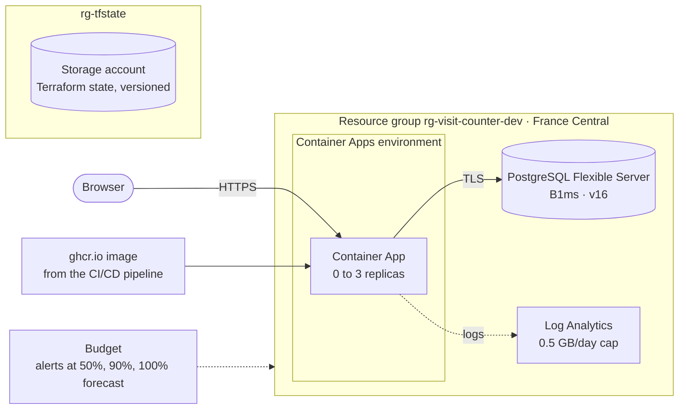

# Terraform Azure deploy

[](https://github.com/MrHamdiChedli/terraform-azure-deploy/actions/workflows/ci.yml)

The visit counter on **Microsoft Azure**, with every resource created by **Terraform**:
the image that [cicd-visit-counter](https://github.com/MrHamdiChedli/cicd-visit-counter) tests and publishes runs on **Azure Container Apps**, with **Azure Database for PostgreSQL**, logs in **Log Analytics**, and a **budget with email alerts**.
It was deployed in France Central, tested over HTTPS, checked for drift, and destroyed, all from code.



## What happened on the real deployment

```
$ terraform apply
Apply complete! Resources: 10 added, 0 changed, 0 destroyed.
app_url = "https://ca-visit-counter-dev.<random>.francecentral.azurecontainerapps.io"

$ bash tests/cloud-smoke-test.sh "$(terraform -chdir=infra output -raw app_url)"
1. The app answers over HTTPS (waking it up if it scaled to zero)
2. Plain HTTP is redirected to HTTPS
3. The counter is stored in Azure Database for PostgreSQL
4. The certificate is valid
PASS: all checks succeeded

$ terraform plan -detailed-exitcode
No changes. Your infrastructure matches the configuration.

$ terraform destroy
```

The environment is destroyed after each test to save the student credit, and `terraform apply` brings it back in about 10 minutes.

## Design choices

| Topic | Choice |
|-------|--------|
| **Remote state** | Stored in an Azure Storage account created by [bootstrap/](bootstrap/main.tf), with **shared keys disabled** (Entra ID roles only), blob versioning to roll back a bad state write, and locking during every operation |
| **Secrets** | The database password is generated by Terraform (`random_password`), passed to the app as a Container Apps secret, and never written in code or variables. The state that contains it is only readable through Entra ID |
| **Cost control** | The app scales to zero when idle, PostgreSQL uses the smallest size (B1ms), log ingestion is capped at 0.5 GB/day, and a monthly budget emails alerts at 50% and 90% spent and at 100% forecast |
| **Immutable deploys** | The image variable rejects `:latest`, so every deploy points to a specific, scanned build |
| **Region** | France Central, one of the regions the Azure for Students policy allows |
| **Health** | Readiness on `/healthz` (checks the database), liveness on TCP only, so a database outage doesn't restart the app |
| **Database access** | Public endpoint with TLS enforced and a firewall that only admits Azure services. See the trade-off below |

**Trade-off I chose consciously:** in production I would put the database on a private network (VNet integration and a private endpoint). On Container Apps' consumption plan, the outbound address isn't fixed, so the firewall allows "Azure services" in general. That's acceptable for a demo with no real data, not for a real customer database.

## CI

Every push runs, without needing Azure credentials:

- `terraform fmt -check` and `terraform validate` on both folders
- [tflint](https://github.com/terraform-linters/tflint) with the Azure ruleset (invalid SKUs, regions, deprecated options)
- a **security scan of the Terraform code** with Trivy (pinned by digest after the March 2026 trivy-action compromise)
- shellcheck on the test script

The deployment itself runs from a workstation: letting GitHub sign in to Azure (OIDC) would mean registering an application in the university's Entra directory, which is not mine to change.

## Run it

You need Terraform 1.9+, the Azure CLI, and a subscription.

```bash
az login

# Once: create the state storage
cd bootstrap
terraform init && terraform apply
terraform output -raw backend_config > ../infra/backend.hcl

# The app
cd ../infra
cp terraform.tfvars.example terraform.tfvars   # set alert_email
terraform init -backend-config=backend.hcl
terraform apply
bash ../tests/cloud-smoke-test.sh "$(terraform output -raw app_url)"

# Clean up
terraform destroy
```

## Problems hit while building it

- **Azure created an "Express" Container Apps environment, which rejects init containers.** The first `apply` created 9 of 10 resources, then failed on the app with `ExpressEnvironmentFeatureNotSupported: 'Init Containers' is not supported`. I had used an init container to create the database table. Adding a Consumption workload profile didn't change the environment's mode, and azurerm 4.x can't set it. The fix moved schema creation where it belongs anyway: [the app now creates its table on first use](https://github.com/MrHamdiChedli/cicd-visit-counter/blob/main/app/app.py), handling two replicas racing to create it. That change went through the CI/CD pipeline (tests, scan, publish) before being deployed here.
- **Drift on the second plan.** After a successful apply, `terraform plan` still wanted to change the app: Express mode stores fixed values for the scaling timers, the traffic split and the probe transport. Some could be set to match (`transport = "http"`); the others azurerm refuses as input, so they are listed in `ignore_changes`, each with the reason. The plan now reports **No changes**.
